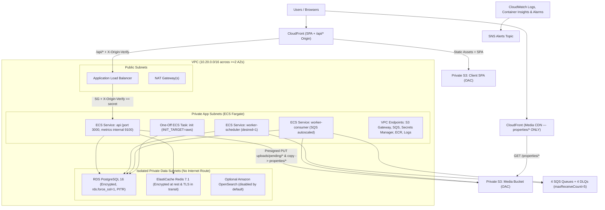

# Nestly AWS Infrastructure (Terraform)

> **Status: Validated & Offline-Planned Only (Never Applied)**
> This directory implements the AWS target architecture from **HLD Sections 3, 4, 11, 13, and 14**. Per project safety rules, Terraform here is **written, linted, security-scanned, mock-tested, and offline-planned only** — no real AWS resources have been provisioned.

---

## Architecture Overview



---

## Layout & Module Overview

| Path | Responsibility |
| --- | --- |
| `modules/network` | Multi-AZ VPC (`var.azs`), public / private-app / isolated-data subnets, NAT gateway(s), CloudFront-prefix-list ALB SG -> API/Worker SG -> Data SG, S3 Gateway + optional Interface VPC endpoints, VPC Flow Logs. |
| `modules/data` | Private encrypted RDS PostgreSQL 16 (`rds.force_ssl = 1`, `deletion_protection = true`, 7-day PITR backups, AWS-managed master secret), ElastiCache Redis 7.1 (at-rest + `rediss://` TLS), optional conditional VPC OpenSearch (`enable_opensearch = false` default -> Postgres FTS fallback). |
| `modules/messaging` | Four primary SQS queues (`notifications`, `provider-actions`, `analytics`, `search-index`) with matching `-dlq` queues, `maxReceiveCount = 5`, SQS SSE encryption, and TLS-only queue policies. |
| `modules/storage_cdn` | Private Media S3 + OAC CloudFront exposing `properties/*` ONLY (viewer-request CloudFront Function denies `/uploads/*`, S3 lifecycle expires unconfirmed `uploads/pending/*` after 1 day), Private Client SPA S3 + OAC CloudFront serving React static assets (`config.js` & `index.html` uncached, SPA rewrite function so `/api/*` 403/404 JSON responses pass untouched) + `/api/*` proxy forwarding `Authorization`, `Idempotency-Key`, `X-Request-Id` with `X-Origin-Verify`. |
| `modules/compute` | Single `nestly-server` ECR repository (`IMMUTABLE` tags, scan on push; no `nestly-client` repo), ALB + `X-Origin-Verify` listener enforcement (403 otherwise), ECS cluster (`ContainerInsights` enabled), `api` / `worker-scheduler` (`desired_count = 1`) / `worker-consumer` / one-off `init` (`INIT_TARGET=aws`) Fargate definitions (`stopTimeout = 30`, `readonlyRootFilesystem = true` with `/tmp` mount, `enable_execute_command = false`, circuit breaker + rollback), autoscaling, empty Secrets Manager containers. |
| `modules/edge` | Conditional `CLOUDFRONT`-scoped AWS WAFv2 WebACL (`enable_waf = false` by default). |
| `modules/observability` | CloudWatch Alarms across all 4 DLQs (depth >= 1), queue oldest message age, ALB 5xx & p95 latency, RDS CPU/connections/storage, Redis CPU/memory/evictions, and ECS CPU -> SNS topic + optional email subscription. |
| `modules/ci_deploy` | GitHub Actions OIDC provider + IAM deploy role restricted strictly to `repo:<github_repo>:environment:production` (`AdityaXwhiz/Nestly`), ECR `nestly-server` push, client S3 sync, CloudFront invalidation, ECS task/service updates, and scoped `iam:PassRole`. |
| `envs/dev` | Real-account dev environment wiring, `backend.tf` (local active by default; encrypted S3 backend documented), mocked `terraform test` suite (`tests/main.tftest.hcl`), and locked providers for `linux_amd64`, `linux_arm64`, and `darwin_arm64`. |
| `envs/offline-plan` | Isolated offline-plan root holding `access_key = "mock"`, `secret_key = "mock"`, and `skip_*` AWS flags with zero AWS-calling data sources (`aws_availability_zones` / `aws_ec2_managed_prefix_list` replaced by variables). |
| `scripts/validate.sh` | Pinned Docker wrapper running `terraform fmt -check`, `validate`, `tflint`, `checkov`, `terraform test`, and offline `terraform plan` (never runs `apply`). Used both locally and in `.github/workflows/ci.yml`. |

---

## Key AWS Design & Hardening Decisions

1. **Dual Layer Origin Protection (`X-Origin-Verify` + CloudFront Prefix List)**: CloudFront injects a generated `X-Origin-Verify` secret header on `/api/*` requests to the ALB, while the ALB SG restricts ingress strictly to CloudFront's managed prefix list (`pl-3b927c52` in `us-east-1`) and the ALB listener returns `HTTP 403` to any request lacking the exact header.
2. **TLS to RDS & ElastiCache**: The `server` Docker image bundles `/etc/ssl/certs/aws-rds-global-bundle.pem` during build; ECS sets `DB_SSL=true`, `DB_SSL_CA_PATH=/etc/ssl/certs/aws-rds-global-bundle.pem`, `PGSSLMODE=verify-full`, `PGSSLROOTCERT=/etc/ssl/certs/aws-rds-global-bundle.pem` while keeping `rejectUnauthorized: true`. RDS enforces `rds.force_ssl = 1` and Redis enforces `transit_encryption_enabled = true` (`rediss://`).
3. **`TRUST_PROXY=2`**: Requests traverse **CloudFront -> ALB -> Express**. Setting `TRUST_PROXY=2` ensures `req.ip` and rate limiters inspect the viewer IP rather than the ALB address. (Single local Nginx uses `TRUST_PROXY=1`.)
4. **`INIT_TARGET=aws` Migration & Init Mode**: In AWS, Terraform pre-provisions SQS queues and S3 buckets, and ECS task roles omit `sqs:CreateQueue` and `s3:CreateBucket`. Running `node src/infrastructure/init.js` with `INIT_TARGET=aws` executes `node-pg-migrate` migrations (plus OpenSearch index/alias creation only if `OPENSEARCH_ENDPOINT` is set) without queue or bucket creation.
5. **Client on S3 + CloudFront (No Client ECR/ECS)**: Only `nestly-server` exists in ECR. `.github/workflows/deploy.yml` builds the Vite bundle, writes runtime `config.js` (`API_BASE_URL: "/api/v1"`) with `no-store, no-cache`, syncs assets to S3, and invalidates CloudFront. A viewer-request CloudFront Function rewrites extensionless SPA paths on `default_cache_behavior` ONLY so `/api/*` `403` and `404` JSON responses pass through unchanged instead of being replaced by `index.html`.
6. **Observability Scope vs Local Prometheus/Grafana**: Local Compose Prometheus and Grafana are **not deployed to AWS**. AWS uses CloudWatch Logs, ECS Container Insights, and CloudWatch Alarms (`modules/observability`). API/Worker Prometheus ports (`9100` / `9101`) remain internal inside ECS tasks and are never attached to the ALB or exposed in security groups.
7. **Secrets Manager Policy**: App secrets (`database-url`, `redis-url`, `jwt-access-secret`, `payment-webhook-secret`) are created as **empty Secrets Manager containers** (`aws_secretsmanager_secret` only — values never touch Terraform state). The only generated secret in Terraform is the CloudFront-to-ALB `origin_verify` header.

---

## Environment `.env` -> AWS Mapping

| App Env Var | Local / Dev Compose | AWS Target (ECS Task Env / Secrets) |
| --- | --- | --- |
| `NODE_ENV` | `development` / `production` | ECS task env: `production` |
| `PORT` | `3000` | ECS task env: `3000` |
| `TRUST_PROXY` | `false` (dev) / `1` (Nginx) | ECS task env: `2` (CloudFront + ALB) |
| `DATABASE_URL` | Local Postgres container | Secrets Manager (`<prefix>/database-url`) -> ECS `secrets` |
| `DB_SSL` / `DB_SSL_CA_PATH` | `false` / unset | ECS task env: `true` / `/etc/ssl/certs/aws-rds-global-bundle.pem` |
| `REDIS_URL` | `redis://redis:6379` | Secrets Manager (`<prefix>/redis-url`, `rediss://...`) -> ECS `secrets` |
| `JWT_ACCESS_SECRET` | Local `.env` | Secrets Manager (`<prefix>/jwt-access-secret`) -> ECS `secrets` |
| `PAYMENT_WEBHOOK_SECRET` | Local `.env` | Secrets Manager (`<prefix>/payment-webhook-secret`) -> ECS `secrets` |
| `PAYMENT_PROVIDER` | `mock` | ECS task env: `mock` (or real gateway when configured) |
| `CORS_ORIGINS` | `http://localhost:5173` | ECS task env: `https://<client_cloudfront_domain>` |
| `S3_ENDPOINT` / `S3_PUBLIC_ENDPOINT` | `http://minio:9000` / `localhost:9000` | Unset (AWS SDK uses region + ECS Task IAM Role) |
| `S3_BUCKET` / `S3_FORCE_PATH_STYLE` | `nestly-media` / `true` | `<prefix>-media-<acct>` / `false` |
| `MEDIA_PUBLIC_BASE_URL` | `http://localhost:9000/nestly-media` | `https://<media_cloudfront_domain>` |
| `SQS_ENDPOINT` / `AWS_ACCESS_KEY_ID` | `http://elasticmq:9324` + test keys | Unset (AWS SDK uses SQS regional URLs + ECS Task IAM Role) |
| `SQS_QUEUE_URL_*` | ElasticMQ queue URLs | SQS queue URLs from `modules/messaging` |
| `OPENSEARCH_ENDPOINT` | `http://opensearch:9200` | `""` when `enable_opensearch=false` (Postgres FTS fallback), else VPC HTTPS endpoint |
| `INIT_TARGET` | `local` | `aws` (migrations + optional OpenSearch alias only) |

---

## State Security & Remote Backend

- `.gitignore` excludes `**/*.tfstate*`, `**/.terraform/`, and `**/*.tfvars` (except `tfvars.example` and `offline.tfvars`), while `.terraform.lock.hcl` IS committed and locked for `linux_amd64`, `linux_arm64`, and `darwin_arm64`.
- `envs/dev/backend.tf` uses local state during offline validation/testing and includes the commented S3 remote state configuration (`encrypt = true`, `use_lockfile = true`) for real AWS usage.

---

## Main AWS Cost Drivers & Dev Controls

Terraform variables default to conservative settings for a dev environment:
- **NAT Gateway hourly & data-processing charges**: mitigated by `single_nat_gateway = true` (single AZ NAT in dev) and S3 Gateway VPC endpoint (free, keeps media/asset traffic off NAT). Set `single_nat_gateway = false` for Multi-AZ production NAT redundancy.
- **VPC Interface Endpoints**: `enable_interface_endpoints = true` provisions PrivateLink endpoints for SQS, Secrets Manager, ECR (`api`+`dkr`), and CloudWatch Logs; can be set `false` in ephemeral dev environments to route AWS API traffic through the NAT Gateway.
- **Managed Data Stores (RDS, ElastiCache, OpenSearch)**: controlled via instance sizes (`db.t4g.micro`, `cache.t4g.micro`), `rds_multi_az = false`, `redis_num_nodes = 1`, and `enable_opensearch = false` (PostgreSQL full-text fallback).
- **ECS Fargate compute**: `api_desired_count = 2`, `worker_consumer_desired_count = 1`, `worker-scheduler` fixed at `1`, `enable_mock_payment_provider = false` by default.
- **Edge WAF**: `enable_waf = false` by default so WAF WebACL baseline charges apply only when explicitly enabled.

---

## Local Validation & Offline Plan

Run all formatting, validation, linting, Checkov scanning, mock tests, and offline planning via pinned Docker images (`hashicorp/terraform:1.11.4`, `ghcr.io/terraform-linters/tflint:v0.55.1`, `bridgecrew/checkov:3.2.390`):

```bash
bash infrastructure/aws/scripts/validate.sh
```

Never run `terraform apply` from `envs/offline-plan`.

- **Offline Plan Summary** (`envs/offline-plan`, saved to `docs/step13d-offline-plan.txt`): `Plan: 154 to add, 0 to change, 0 to destroy.` (with default `enable_opensearch = false`, `enable_waf = false`, `enable_mock_payment_provider = false`).
- **TFLint**: `tflint --recursive` passes with zero errors/warnings (`terraform` + `tflint-ruleset-aws 0.37.0`).
- **Terraform Mock Tests**: `envs/dev/tests/main.tftest.hcl` passes (`2 passed, 0 failed`), verifying RDS/Redis encryption & `deletion_protection`, all 4 S3 public-access block flags, SQS `maxReceiveCount = 5`, Media CDN `properties/*`-only routing, Client `/api/*` header forwarding & `CachingDisabled`, ALB `X-Origin-Verify` enforcement, ECS hardening (`worker-scheduler` count `1`, `stopTimeout = 30`, `readonlyRootFilesystem = true`, `enable_execute_command = false`), GitHub OIDC scoping, and parsed JSON IAM policies.

### Checkov Suppressions & Justifications

`checkov` (`bridgecrew/checkov:3.2.390`) reports **286 passed, 0 failed** (`2` inline skips for `CKV_AWS_305` on `aws_cloudfront_distribution.media` across `dev` and `offline-plan` roots). No wildcard IAM actions/resources, public RDS/S3, or open `0.0.0.0/0` application ingress rules are suppressed. Suppressions in `.checkov.yaml` & inline comments reflect deliberate dev-baseline or architectural constraints:

| Check ID(s) | Scope & Rationale |
| --- | --- |
| `CKV_AWS_305` (inline on `media` CloudFront) | Media CloudFront intentionally exposes `properties/*` only and returns `403 Forbidden` on `/` and `/uploads/*` via a viewer-request CloudFront Function. |
| `CKV_AWS_136`, `CKV_AWS_145`, `CKV_AWS_149`, `CKV_AWS_158`, `CKV_AWS_191`, `CKV_AWS_354` | AWS-managed encryption (`AES256` / default KMS keys) is used instead of paid Customer Managed KMS Keys in the dev baseline. |
| `CKV_AWS_157`, `CKV2_AWS_50`, `CKV_AWS_118`, `CKV_AWS_338`, `CKV2_AWS_52`, `CKV2_AWS_59` | Dev cost controls (`rds_multi_az = false`, `redis_num_nodes = 1`, 30-day CloudWatch retention, optional OpenSearch off by default); configurable via variables for prod. |
| `CKV_AWS_31`, `CKV2_AWS_57` | Secrets Manager containers are intentionally empty (populated out-of-band, zero secrets in Terraform state) and Redis omits static `auth_token` in TF state while enforcing TLS + isolated data-subnet SGs. |
| `CKV_AWS_68`, `CKV2_AWS_28`, `CKV2_AWS_42`, `CKV2_AWS_47`, `CKV_AWS_174`, `CKV_AWS_378` | Optional WAFv2 (`enable_waf = false`) and custom ACM domain cert (`alb_acm_certificate_arn = null`) remain off until a custom domain is attached; CloudFront default cert requires `TLSv1`, and CloudFront -> ALB uses CloudFront prefix list SG + `X-Origin-Verify`. |
| `CKV_AWS_18`, `CKV_AWS_86`, `CKV_AWS_91`, `CKV2_AWS_31`, `CKV2_AWS_62`, `CKV_AWS_144`, `CKV_AWS_310`, `CKV_AWS_374` | Dev baseline omits dedicated access-log S3 buckets, CRR, S3 notifications, origin failover groups, and geo-blocking. |
| `CKV2_AWS_5` | Checkov scans `modules/network` standalone as well as `envs/`; all security groups in `modules/network` are attached in `modules/compute` and `modules/data`. |

---

## How I Would Apply This (Manual AWS Deployment Runbook)

1. **Create an AWS Billing Budget & Cost Anomaly Alert first** in AWS Budgets before creating any paid resources.
2. **Create a remote Terraform state S3 bucket** (private, versioned, SSE encrypted), update and uncomment `infrastructure/aws/envs/dev/backend.tf`.
3. **Create app database role & prepare secrets**: create `infrastructure/aws/envs/dev/terraform.tfvars` from `terraform.tfvars.example` with real `aws_account_id` (kept out of git).
4. **Initialize & review plan**:
   ```bash
   cd infrastructure/aws/envs/dev
   terraform init -migrate-state
   terraform plan -out=tfplan
   ```
   Review every resource in `tfplan`, then run `terraform apply tfplan`.
5. **Populate Secrets Manager containers** (`<prefix>/database-url`, `<prefix>/redis-url` with `rediss://`, `<prefix>/jwt-access-secret`, `<prefix>/payment-webhook-secret`) using the RDS/Redis endpoints from `terraform output` and `openssl rand -hex 32` for HMAC/JWT keys.
6. **Configure GitHub Protected Environment (`production`)**: set secret `AWS_DEPLOY_ROLE_ARN` from `terraform output -raw github_deploy_role_arn` and repo variables (`ECR_SERVER_REPOSITORY`, `CLIENT_S3_BUCKET`, `CLIENT_CLOUDFRONT_ID`, `CLIENT_CLOUDFRONT_URL`, `ECS_CLUSTER_NAME`, `PRIVATE_APP_SUBNETS`, `WORKER_SECURITY_GROUP_ID`, `AWS_DEPLOY_ENABLED=true`). Trigger `.github/workflows/deploy.yml` manually via `workflow_dispatch`.
7. **Tear down cleanly when done**: temporarily set `deletion_protection = false` and `skip_final_snapshot = true` in dev `terraform.tfvars`, apply that variable update, then run `terraform destroy`.
